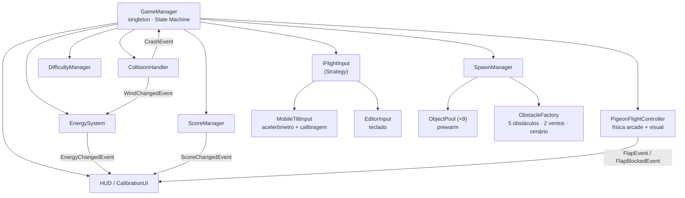
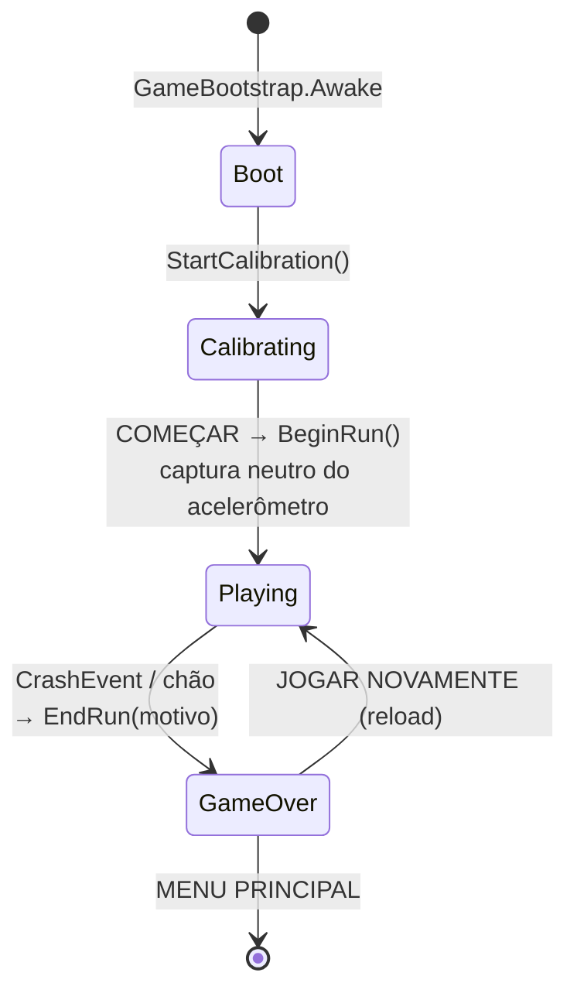
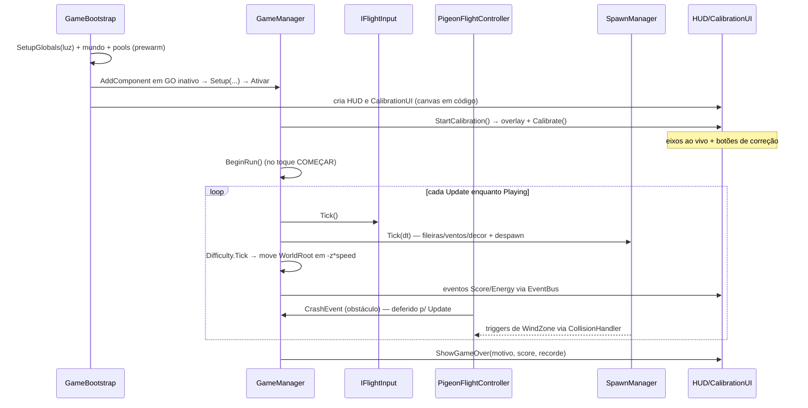

# Arquitetura — Pigeon Rooftop Rush

Complementa o plano ([`plano-implementacao.md`](plano-implementacao.md)) com os
diagramas finais do projeto implementado.

## 1. Sistema (fiel ao diagrama do PDF)



**Event Bus:** `EventBus` estático tipado (`Subscribe/Unsubscribe/Raise<T>`). Todo
`Subscribe` de MonoBehaviour usa *method group* e é pareado em `OnDisable` — sem
vazamentos entre cenas.

## 2. Estados da run



## 3. Sequência de uma partida



## 4. Padrões aplicados (PDF)

| Padrão | Implementação |
|---|---|
| Singleton | `GameManager.Instance` (limpo em `OnDestroy`) |
| State Machine | `GameState { Boot, Calibrating, Playing, GameOver }` |
| Strategy | `IFlightInput` ← `MobileTiltInput` / `EditorInput` (escolhido em runtime por `Application.isMobilePlatform`) |
| Observer / Event Bus | `EventBus` + eventos struct (`ScoreChangedEvent`, `EnergyChangedEvent`, `CrashEvent`…) |
| Object Pooling | `ObjectPool` por chave com prewarm, usado exclusivamente pelo `SpawnManager` |
| Composition Root | `GameBootstrap` / `MainMenuBootstrap` (montam tudo em runtime) |

## 5. Fluxo de dados do voo (por FixedUpdate)

```
IFlightInput.Steer ──┬─→ vx = steer.x × strafeSpeed
                     └─→ vy += steer.y × tiltLiftAccel × dt
gravidade (normal 9.5 | glide 2.4 | azul ×0.3 | vermelha ×1.6)
FlapPressed ──→ Energy.TryConsumeFlap() ──ok──→ vy += 6.5
MovePosition(pos clamped em X ±7.5 / Y 0.6..22 / Z 0)
GroundTouched (Y ≤ 0.6 caindo) ──→ EndRun(Ground)
```

O **mundo** se move (`WorldRoot.position.z -= speed × dt`); o pombo fica em z = 0.
Isso mantém floats estáveis em runs longas e simplifica o pooling (despawn em z < −14).

## 6. Cenas e montagem (decisão E1)

As cenas `.unity` contêm **apenas**: settings padrão + Main Camera + Directional Light
+ Global Volume + 1 bootstrap — blocos copiados do template original (YAML comprovado)
com remapeamento de `fileID` por `tools/gen_scenes.py`.

Tudo o mais é criado em `Awake()`:

```
GameBootstrap.Awake
 ├─ WorldBuilder: globals de luz/névoa/céu, chão, sombra blob, WorldRoot
 ├─ Systems (GO inativo) → GameManager + Score + Difficulty + SpawnManager(pools)
 ├─ PigeonBuilder → RB + trigger + CollisionHandler + Flight + modelo (primitivas)
 ├─ HUD / CalibrationUI (canvas + widgets em código via UiFactory)
 ├─ Ativar GOs (Awakes rodam com refs prontas) + EventSystem (InputSystemUIInputModule)
 └─ gm.StartCalibration()
```

## 7. Shaders próprios (decisão E2)

| Shader | Uso | Como recebe luz/nevoa |
|---|---|---|
| `Pombo/Flat` | sólidos (obstáculos, pombo, chão) | lambert com uniforms globais `_PomboLightDir/_PomboLightColor/_PomboAmbient/_PomboFog*` setados pelo `WorldBuilder` a partir da luz da cena |
| `Pombo/Transparent` | ventos, sombras blob | alpha blend + mesma névoa |

- Só usam APIs estáveis de `Core.hlsl` (zero dependência de GUIDs de pacote).
- Registrados em **Always Included Shaders** (`GraphicsSettings.asset`) ⇒
  `Shader.Find` funciona no build.
- Clear color da câmera = valor bruto da névoa ⇒ horizonte sem emenda.

## 8. Decisões de dados importantes

| Dado | Local | Persistência |
|---|---|---|
| Recorde | `ScoreManager` | `PlayerPrefs["PRR_BestScore"]` |
| Neutro do sensor | `SensorCalibration` | memória da sessão (recalibra por partida) |
| Eixos invertidos | `SensorCalibration` (público) | padrão no código + botões no CalibrationUI |
| Tuning (velocidades, custos) | constantes nos próprios scripts | documentadas no GDD §5–8 |

## 9. Por que sem prefabs/SO authorados?

Este ambiente de escrita não tem o Editor Unity para salvar cenas/prefabs/SO sem risco
de YAML inválido. A estratégia de **factories em runtime** (`PigeonBuilder`,
`ObstacleFactory`, `UiFactory`) mantém a arquitetura pedida (pools, sistemas
separados) e troca-se por assets authorados depois, se desejado: basta substituir o
corpo das factories por `PrefabReference`.
