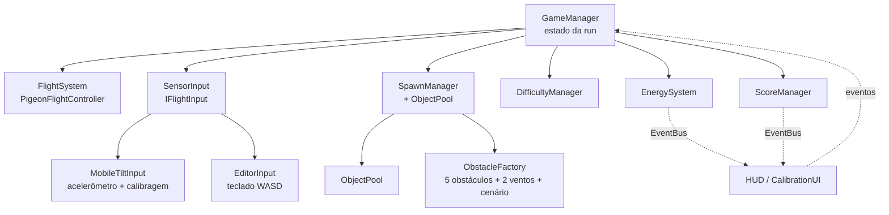
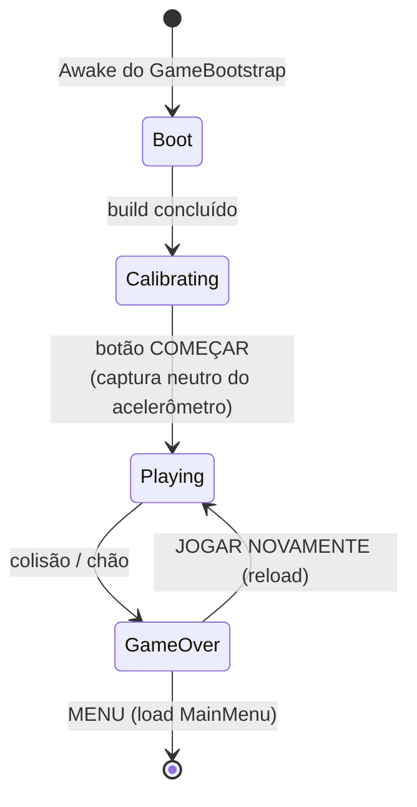
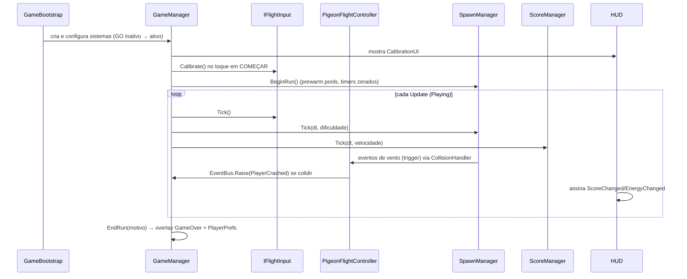

# Plano de Implementação — Projeto 2: 🏙 Pigeon Rooftop Rush

> **Repositório:** `AndoreBG/pombo-runner` · **Branch:** `arena/2d5d83ad-pombo-runner`
> **Engine:** Unity 6000.3.18f1 (URP 17.3.0) · **Plataforma alvo:** Android (paisagem)
> **Data:** 2026-11-26

Este documento é o plano completo de implementação que sigo **passo a passo** durante o
desenvolvimento. Cada fase tem entregáveis e critérios de aceite verificáveis.

---

## 1. Contexto e escopo acordado

Decisões confirmadas com o usuário:

| Tema | Decisão |
|---|---|
| **Escopo** | **MVP estrito do PDF**: voo 3D, sensor de inclinação, calibragem, 5 obstáculos, 2 correntes de ar, energia, score, pooling, build Android. |
| **Validação** | Este ambiente **não tem Unity** — eu escrevo tudo, o usuário abre no Unity local e me envia erros de compilação/console para eu corrigir. |
| **Visual** | **Primitivas estilizadas** (cubos, cápsulas, esferas) com materiais URP de cor, estilo arcade minimalista. |
| **Cenas** | **2 cenas**: `MainMenu` + `Game` (game over como overlay dentro de Game). |
| **Entregáveis** | Código + README + GDD + diagrama de arquitetura + plano de testes + template de post-mortem + roteiro da apresentação (~10 min). |

### 1.1 Fora do escopo (pós-MVP, documentado no GDD)

Power-ups (Super Planador, Pena Dourada, Escudo, Migalhas Magnéticas), 5 zonas de
progressão (Centro → Bairro → Parque → Industrial → Noturno), haptics, gestos de swipe
(mergio/freio), demais obstáculos do GDD (drones, janelas, outros pássaros), corrente
verde (favorável), áudio, menu de pausa. Tudo isso fica no roadmap pós-MVP.

---

## 2. Restrições do ambiente e estratégias derivadas

O sandbox **não tem Unity, dotnet nem mono** → não posso compilar nem executar.
Isso define três estratégias centrais:

### E1 — Montagem de cena em tempo de execução (runtime bootstrap)
As cenas YAML terão **apenas**: RenderSettings/Lightmap/NavMesh padrão + Main Camera +
Directional Light + Global Volume (blocos **copiados do `gameplay.unity` existente**,
que já são YAML comprovadamente válido com GUIDs corretos do URP) + **1 GameObject
Bootstrap** com 1 script. Todo o resto (jogador, pools, spawnners, HUD, overlays,
cenário) é construído **por código** nos `Awake()` dos bootstraps.

*Benefício:* elimina centenas de linhas de YAML autor à mão (principal fonte de erro
silencioso sem editor). *Contrapartida:* os "prefabs" são criados por factories em
código — a arquitetura de pooling/factories do PDF é preservada.

### E2 — Shaders próprios, autocontidos
Os materiais não podem depender de GUIDs de shaders do pacote URP (risco de erro
silencioso). Escrevo 2 shaders ShaderLab próprios (`Pombo/Flat` opaco lambert e
`Pombo/Transparent`), usando apenas APIs estáveis de `Core.hlsl`
(`TransformObjectToHClip`, `TransformObjectToWorldNormal`). A direção/cor da luz
vêm de uniforms globais setados pelo meu código. Para garantir inclusão no build,
os 2 shaders entram em **Always Included Shaders** (`GraphicsSettings.asset`).
Sombras "blob" (quads escuros no chão) substituem shadow-maps — visual arcade e zero
risco de pass de sombra.

### E3 — Validação estática rigorosa (substitui o compilador)
Antes de entregar, rodo `tools/validate.py`:
1. **Sintaxe C#** com `tree-sitter-c-sharp` (instalado via pip) em todos os `.cs` — zero nós de erro;
2. **Metas:** todo asset sob `Assets/` tem `.meta`, todo `.meta` tem asset, GUIDs únicos;
3. **Referências de cena:** todo `guid:` citado em `.unity` existe em algum `.meta` (ou é built-in `0000…e000/f000`);
4. **Scripts de cena:** o `.cs` referenciado contém a classe com o nome do arquivo;
5. **Build settings:** os caminhos das cenas em `EditorBuildSettings.asset` existem;
6. Balanceamento de chaves/parênteses e consistência de `namespace`.

---

## 3. Arquitetura

### 3.1 Diagrama de sistemas (fiel ao PDF)



### 3.2 Padrões do PDF aplicados

| Padrão | Onde |
|---|---|
| **Singleton** | `GameManager.Instance` (serviço global da run) |
| **Strategy** | `IFlightInput` → `MobileTiltInput` / `EditorInput` |
| **Observer/Event Bus** | `EventBus` estático com eventos tipados |
| **Object Pooling** | `ObjectPool` + `SpawnManager` (MVP) |
| **State Machine** | `GameState` (Boot → Calibrating → Playing → GameOver) |

### 3.3 Fluxo de estados



### 3.4 Loop de uma run (sequência)



---

## 4. Modelo de jogo (números de tuning)

Esses valores ficam em constantes/serialized defaults nos scripts e são documentados
no GDD. São o ponto de partida — o usuário ajusta depois no Inspector/código.

### 4.1 Voo (PigeonFlightController)

| Parâmetro | Valor | Descrição |
|---|---|---|
| `strafeSpeed` | 6.5 m/s | velocidade lateral máxima (tilt X) |
| `tiltLiftAccel` | 26 m/s² | aceleração vertical do tilt Y |
| `gravity` (normal) | 9.5 m/s² | gravidade em voo normal |
| `gravityGlide` | 2.4 m/s² | gravidade planando (hold) |
| `flapBoost` | +6.5 m/s | impulso vertical por tap |
| `maxClimb` / `maxDive` | 9 / 12 m/s | limites de vy |
| `boundsX` | ±7.5 | limites laterais |
| `boundsY` | 0.6 … 22 | chão e teto |
| `fixedDeltaTime` | 1/60 | definido no bootstrap (tunneling fino) |

O mundo se move em −Z (speed constante da run); o pombo fica em z = 0.
Isso evita drift de ponto flutuante em runs longas.

### 4.2 Energia (EnergySystem) — 0…100, começa em 100

| Ação | Efeito |
|---|---|
| Voo normal (nem flap nem glide) | −3.0/s |
| Tap (bater asas) | −6 por tap |
| Hold (planar) | −1.4/s |
| Corrente azul (ascendente) | +9/s **e** empuxo + gravidade ×0.3 enquanto dentro |
| Corrente vermelha (turbulência) | −8/s **e** gravidade ×1.6 + tremor de câmera |
| Energia = 0 | sem flap (impulso bloqueado), voo normal continua — o jogador precisa pegar corrente azul para recuperar; cair no chão = crash |

Sem energia não há morte instantânea: a tensão é chegar ao chão.

### 4.3 Progressão/dificuldade (DifficultyManager)

| Parâmetro | Início | Máx (em ~150 s) |
|---|---|---|
| Velocidade do mundo | 9 m/s | 24 m/s |
| Intervalo de spawn | 1.55 s | 0.62 s |
| Chance de 2 obstáculos na fileira | 0 % | 45 % (com corredor garantido ≥ 1 lane) |
| Intervalo de correntes | 8 s | 5 s |

### 4.4 Score (ScoreManager)

`score = floor(distância percorrida em m) + 25 × obstáculos ultrapassados`.
High score em `PlayerPrefs` (`PRR_BestScore`).

### 4.5 Controles

**Mobile (`MobileTiltInput`)** — `Input.compensatingSensors = true` para que o
acelerômetro seja reportado no **frame da tela atual** (resolve LandscapeLeft/Right);
neutro capturado na calibragem (com refinamento exponencial de 0,5 s após o toque);
dead-zone 0.08; flags `invertX/invertY/swapXY` no inspector + leitura crua no
`CalibrationUI` para o usuário verificar/ajustar os eixos no dispositivo.

| Entrada | Ação |
|---|---|
| Inclinar ←/→ | virar (X) |
| Inclinar ↑/↓ | subir/mergulhar (Y) |
| Tap na tela | bater asas (−6 energia) |
| Segurar > 0,22 s | planar (hold) |

**Editor (`EditorInput`)** — `WASD`/setas = tilt, `Espaço` = flap, `Shift esq.` = glide.

**Calibragem:** todo run começa com overlay "aparelho na posição neutra →
COMEÇAR"; há atalho de mouse no editor. O overlay mostra X/Y brutos ao vivo.

### 4.6 Os 5 obstáculos (ObstacleFactory)

| # | Obstáculo | Geometria (primitivas) | Esquiva |
|---|---|---|---|
| 1 | **Prédio** | cubo alto (larg. 3–4, alt. 12–16) desde o chão | por cima |
| 2 | **Antena** | cilindro fino (alt. 10–14) + base | lateral |
| 3 | **Fio elétrico** | caixa fina atravessando a pista inteira (alt. 4–16, alt. 0.6) | por cima ou por baixo |
| 4 | **Outdoor** | caixa larga flutuando (6 × 0.8 × 2.5) | por cima/baixo/lado |
| 5 | **Árvore** | cilindro (tronco) + esfera (copa) | por cima/lado |

Lanes de spawn: x ∈ {−6, −3, 0, 3, 6}. Fileiras com 1 obstáculo, ou 2 com
distância ≥ 2 lanes (corredor garantido).

### 4.7 As 2 correntes de ar (MVP)

| Cor | Tipo | Efeito |
|---|---|---|
| **Azul** `#3EC6FF` | ascendente | +9/s energia, gravidade ×0.3, coluna visível com listras subindo |
| **Vermelha** `#FF5252` | turbulência | −8/s energia, gravidade ×1.6, tremor de câmera, listras tremendo |

(Verde favorável fica pós-MVP.) Volumes trigger 10 × 18 × 6, spawn em x aleatório.

---

## 5. Estrutura de arquivos

### 5.1 Scripts (lista do PDF + adições justificadas)

```
Assets/Scripts/
 ├── Core/
 │    ├── GameManager.cs            (PDF) singleton + State Machine + Update loop
 │    └── EventBus.cs               (PDF) eventos tipados + tipos de evento
 ├── Input/
 │    ├── IFlightInput.cs           (PDF) Strategy
 │    ├── MobileTiltInput.cs        (PDF) acelerômetro + compensação de orientação
 │    ├── EditorInput.cs            (PDF) teclado (mesmo nome do diagrama: EditorKeyboardInput)
 │    └── SensorCalibration.cs      (PDF) neutro, dead-zone, eixos
 ├── Player/
 │    ├── PigeonFlightController.cs (PDF) física arcade + visual (roll/pitch/asa)
 │    ├── EnergySystem.cs           (PDF) tabela da §4.2
 │    └── CollisionHandler.cs       (PDF) triggers: obstáculo/vento → EventBus
 ├── World/
 │    ├── SpawnManager.cs           (PDF) fileiras, correntes, cenário, despawn
 │    ├── ObjectPool.cs             (PDF) pool genérico por chave
 │    ├── WindZone.cs               (PDF) enum + efeito + listras animadas
 │    ├── ObstacleFactory.cs        (ADIÇÃO) constrói os 5 obstáculos/ventos/decor em código
 │    └── WorldBuilder.cs           (ADIÇÃO) chão, faixas, prédios laterais, luz/config do mundo
 ├── Gameplay/
 │    ├── ScoreManager.cs           (PDF)
 │    └── DifficultyManager.cs      (PDF)
 ├── UI/
 │    ├── HUD.cs                    (PDF) score, energia, velocidade, overlays
 │    ├── CalibrationUI.cs          (PDF)
 │    ├── MainMenuUI.cs             (ADIÇÃO) menu precisa de UI
 │    └── UiFactory.cs              (ADIÇÃO) helper de construção de uGUI em código
 └── Boot/
      ├── GameBootstrap.cs          (ADIÇÃO) monta a cena Game em runtime
      └── MainMenuBootstrap.cs      (ADIÇÃO) monta a cena MainMenu em runtime
```

> `PowerupManager.cs` do PDF **não** é implementado: power-ups não estão no MVP
> (decisão registrada na §1.1).

### 5.2 Shaders, cenas, settings, tools, docs

```
Assets/Shaders/PomboFlat.shader         lambert próprio (opaque)
Assets/Shaders/PomboTransparent.shader  alpha blend (ventos, sombras blob)
Assets/Scenes/MainMenu.unity            YAML mínimo + MainMenuBootstrap
Assets/Scenes/Game.unity                YAML mínimo + GameBootstrap
Assets/Scenes/gameplay.unity            ← REMOVIDO (era só a cena template vazia)
tools/gen_scenes.py                     gera as 2 cenas (copia blocos do template)
tools/gen_meta.py                       gera .meta com GUIDs únicos
tools/validate.py                       E3 — validação estática
docs/plano-implementacao.md             este documento
README.md                               instruções (abrir, controles, build Android)
docs/gdd.md                             GDD final do Projeto 2
docs/arquitetura.md                     diagrama detalhado (Mermaid)
docs/plano-de-testes.md                 checklist de teste em dispositivo
docs/post-mortem-template.md            template 1–2 páginas
docs/apresentacao.md                    roteiro ~10 minutos
```

### 5.3 Settings alterados

| Arquivo | Mudança |
|---|---|
| `ProjectSettings.asset` | `activeInputHandler: 2` (Both — sensores legacy + Input System p/ UI); paisagem só (`allowedAutorotateToPortrait/UpDown: 0`); `productName: Pigeon Rooftop Rush`; `applicationIdentifier Android: com.pomborunner.pigeonrooftoprush` |
| `GraphicsSettings.asset` | +2 shaders em `m_AlwaysIncludedShaders` |
| `EditorBuildSettings.asset` | cenas: `MainMenu` (0), `Game` (1); remove referência fantasma a `SampleScene` |
| `TagManager.asset` | sem mudança (marcadores por componente, não por tag) |
| `Packages/manifest.json` | sem mudança (Input System, URP, uGUI já presentes) |

---

## 6. Fases de implementação

Cada fase termina com `tools/validate.py` verde antes de seguir.

| # | Fase | Entregáveis | Critério de aceite | Status |
|---|---|---|---|---|
| **F0** | Planejamento | este documento | aprovado pelo usuário | ✅ |
| **F1** | Ferramentas | `tools/gen_meta.py`, `tools/validate.py`, `tools/gen_scenes.py` | validação roda e reporta | ✅ |
| **F2** | Settings | §5.3 aplicada; `gameplay.unity` removido | arquivos YAML íntegros | ✅ |
| **F3** | Shaders | 2 shaders + metas + Always Included | validate: GUIDs ok | ✅ |
| **F4** | Core + Input | EventBus, GameManager, IFlightInput, MobileTiltInput, EditorInput, SensorCalibration | sintaxe ok | ✅ |
| **F5** | Player | PigeonFlightController, EnergySystem, CollisionHandler, PigeonBuilder (visual) | sintaxe ok | ✅ |
| **F6** | World + Gameplay | ObjectPool, SpawnManager, WindZone, ObstacleFactory, WorldBuilder, ScoreManager, DifficultyManager | sintaxe ok | ✅ |
| **F7** | UI + Boot | UiFactory, HUD, CalibrationUI, MainMenuUI, GameBootstrap, MainMenuBootstrap | sintaxe ok | ✅ |
| **F8** | Cenas | `gen_scenes.py` gera MainMenu + Game com GUIDs corretos | validate: refs ok | ✅ |
| **F9** | Revisão estática | passada de leitura humana (eu) + validate completo + revisão de números vs. GDD | 0 erros | ✅ |
| **F10** | Documentação | README, GDD, arquitetura, plano de testes, post-mortem, apresentação | completos | ✅ |
| **F11** | Entrega | commits na branch `arena/2d5d83ad-pombo-runner` + push | histórico limpo | ✅ |

### Registro de execução (F9 — achados corrigidos)

1. **`CalibrationUI.Show()/Hide()` ausentes** → erro de compilação pego na revisão de
   assinaturas (métodos chamados pelo `GameManager`).
2. **Pitch do mergulho com sinal invertido** (nariz para cima ao mergulhar) → corrigido
   para `vy ≥ 0: −vy·2.2` (nariz para cima) / `vy < 0: −vy·1.2` (nariz para baixo).
3. **`EndRun` dentro de callback de física** → crash agora é adiado para o `Update`
   (`_pendingCrash`).
4. **Refinamento do neutro “puxando” o calibre durante o voo** → só refina enquanto o
   acelerômetro está parado (Δ < 0,15); para assim que o jogador inclina.
5. **Layouts de UI** → painel de game over 500→540 (botão transbordava), calibragem
   reposicionada (5 linhas de corpo), label de energia movida para cima da barra
   (legibilidade sobre fundo escuro).
6. **Câmera** → `GetComponent<Camera>()` cacheado; campo morto `_shakeIntensity`
   removido.
7. **YAML do bootstrap** → campos vazios com espaço final (formato exato do Unity).

**Pós-entrega (ciclo com o usuário):** ele abre no Unity 6000.3.18f1, compila, testa
no editor e no aparelho, me manda erros/console → eu corrijo (F9′).

---

## 7. Riscos e mitigações

| Risco | Impacto | Mitigação |
|---|---|---|
| Erro de sintaxe C# (sem compilador) | build falha | `tree-sitter-c-sharp` em todos os `.cs` (E3.1) |
| GUID errado em cena/script | script missing na cena | tudo gerado/validado por ferramenta (E3.3–5) |
| Eixo do tilt invertido no aparelho | controle ruim | `compensatingSensors` + calibragem + flags `invertX/invertY/swapXY` + leitura crua no CalibrationUI + item dedicado no plano de testes |
| Shader não incluído no build (magenta) | visual quebrado | Always Included Shaders (E2) + shader próprio sem dependência de pacote |
| UI do Input System sem ações atribuídas | botões não clicam | `InputSystemUIInputModule` auto-atribui ações padrão (comportamento documentado); item no plano de testes |
| Tunneling de gatilho em alta velocidade | colisão perdida | `fixedDeltaTime` 60 Hz + obstáculos com ≥0,6 m de espessura + teste no plano de testes |
| YAML de cena inválido | cena não abre | blocos copiados de `gameplay.unity` (já válido) + validação de referências |
| Touch na tela conflita com botões | flap indevido | input só responde no estado `Playing` |

---

## 8. Plano de validação (resumo — detalhado em `docs/plano-de-testes.md`)

1. **Estático (eu, agora):** `tools/validate.py` → sintaxe, metas, GUIDs, cenas, build settings.
2. **Editor (usuário):** abrir projeto → sem erros de importação → Play no `MainMenu`
   → JOGAR → calibrar → jogar → colidir → GameOver → reiniciar/menu.
3. **Dispositivo (usuário):** build Android → verificar eixos do tilt, calibragem,
   tap/hold, ventos, energia, colisões, 60 fps, paisagem.
4. **Correções:** usuário me envia erros → eu corrijo → repete 1.

---

*Fim do plano. Início da execução: F1.*
